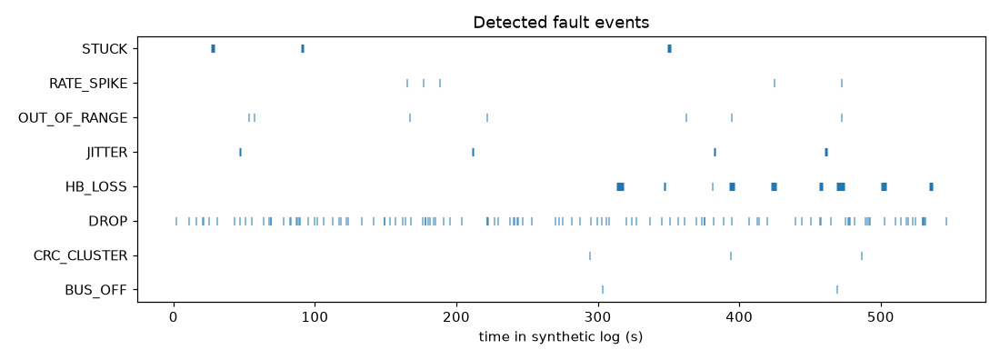
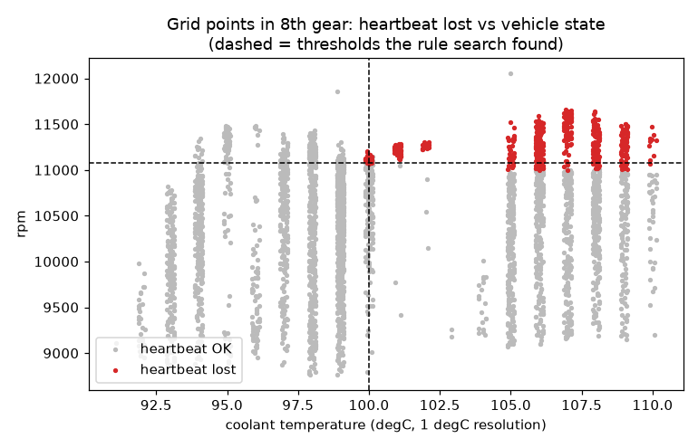
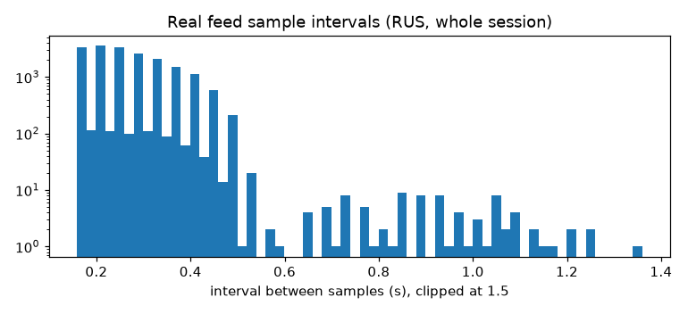

# Fault Hunter report

Generated by `make report` from `results/`. Synthetic numbers come from the seeded CAN log;
real-data numbers come from public F1 telemetry. Nothing here is about a real car's faults.

## Synthetic CAN log

- seed 42, 7 laps, 546.69 s of driving, 157926 frames, 151 error frames
- C++ decoder: 164018 frames/s single-threaded (0.963 s incl. writing CSV)
- CRC-15: 87/87 corrupted frames flagged, 0 false CRC errors

| fault type | injected | detected | precision | recall |
|---|---|---|---|---|
| BUS_OFF | 2 | 2 | 1.0 | 1.0 |
| DROP | 151 | 151 | 1.0 | 1.0 |
| EMI_BURST | 3 | 3 | 1.0 | 1.0 |
| HB_LOSS | 9 | 9 | 1.0 | 1.0 |
| JITTER | 4 | 4 | 1.0 | 1.0 |
| OUT_OF_RANGE | 7 | 7 | 1.0 | 1.0 |
| RATE_SPIKE | 8 | 8 | 1.0 | 1.0 |
| STUCK | 3 | 3 | 1.0 | 1.0 |

### Fault signatures (grouped like regression failures)

| signature | events | first (s) | last (s) |
|---|---|---|---|
| DROP 0D0 | 61 | 18.57 | 545.99 |
| DROP 0C0 | 37 | 20.76 | 530.45 |
| DROP 0E0 | 30 | 10.61 | 531.25 |
| DROP 3F0 | 10 | 1.61 | 491.11 |
| HB_LOSS 3F0 | 9 | 313.36 | 536.16 |
| DROP 200 | 7 | 88.51 | 476.41 |
| DROP 1A0 | 6 | 121.71 | 477.01 |
| RATE_SPIKE 0C0 rpm | 5 | 37.12 | 529.50 |
| JITTER 0C0 | 4 | 46.13 | 461.49 |
| OUT_OF_RANGE 1A0 soc | 4 | 56.91 | 472.01 |
| RATE_SPIKE 0E0 speed | 3 | 176.53 | 424.21 |
| CRC_CLUSTER - | 3 | 294.15 | 486.18 |
| OUT_OF_RANGE 0C0 water_temp | 3 | 52.71 | 394.13 |
| BUS_OFF 0D0 | 2 | 303.15 | 468.92 |
| STUCK 0C0 rpm | 1 | 349.42 | 350.91 |
| STUCK 0D0 brake_front | 1 | 26.53 | 28.52 |
| STUCK 0E0 speed | 1 | 90.27 | 91.45 |

### Root cause of the intermittent heartbeat loss

- injected (hidden) trigger: `gear == 8 and rpm >= 11000 and water_temp >= 100`
- grid points (one per 50 ms heartbeat slot): 10933, with heartbeat lost: 498
- detected-loss labels vs true trigger: precision 1.0, recall 0.982

**Search over vehicle-state features:** `gear == 8 and rpm >= 11079 and water_temp >= 100`, vs true trigger: precision 0.978, recall 0.892

| step | rule | P | R | F1 |
|---|---|---|---|---|
| 1 | `gear == 8` | 0.148 | 1.000 | 0.257 |
| 2 | `gear == 8 and rpm >= 11079` | 0.689 | 0.908 | 0.783 |
| 3 | `gear == 8 and rpm >= 11079 and water_temp >= 100` | 0.978 | 0.908 | 0.942 |

Runners-up: `gear == 8 and speed >= 336 and water_temp >= 101` (F1 0.935); `speed >= 336 and rpm >= 11079 and water_temp >= 100` (F1 0.927); `gear == 8 and speed >= 336 and rpm >= 11079` (F1 0.77); `lap_distance <= 498.24 and water_temp >= 101 and speed >= 335.9` (F1 0.631)

**Search over plus slowly trending signals (SoC, battery temp):** `speed >= 336 and batt_temp >= 36 and rpm >= 11011`, vs true trigger: precision 0.998, recall 0.915

| step | rule | P | R | F1 |
|---|---|---|---|---|
| 1 | `speed >= 336` | 0.418 | 0.926 | 0.576 |
| 2 | `speed >= 336 and batt_temp >= 36` | 0.909 | 0.926 | 0.917 |
| 3 | `speed >= 336 and batt_temp >= 36 and rpm >= 11011` | 0.991 | 0.926 | 0.957 |

Runners-up: `gear == 8 and rpm >= 11079 and batt_temp >= 36` (F1 0.951); `gear == 8 and rpm >= 11079 and soc <= 48` (F1 0.948); `speed >= 336 and batt_temp >= 36 and soc <= 48` (F1 0.947); `speed >= 336 and batt_temp >= 36 and water_temp >= 100` (F1 0.943)

## Real F1 telemetry (public feed)

Session: OpenF1: 2024 Silverstone Qualifying (session 9554). All drivers share identical timestamps: True. Distinct on-track gap instants (> 1 s): 17.

| driver | on-track samples | rate (Hz) | dt median / p95 / max (s) | gaps > 1 s | throttle = 104 | brake values | stuck rpm runs | speed jumps > 300 km/h/s |
|---|---|---|---|---|---|---|---|---|
| HAM | 10475 | 4.17 | 0.24 / 0.401 / 1.36 | 16 | 1083 | [0, 100, 104] | 0 | 0 |
| NOR | 10332 | 4.17 | 0.24 / 0.401 / 1.36 | 16 | 1784 | [0, 100, 104] | 0 | 0 |
| RUS | 10769 | 4.17 | 0.24 / 0.401 / 1.241 | 15 | 939 | [0, 100, 104] | 0 | 0 |

## Plots

